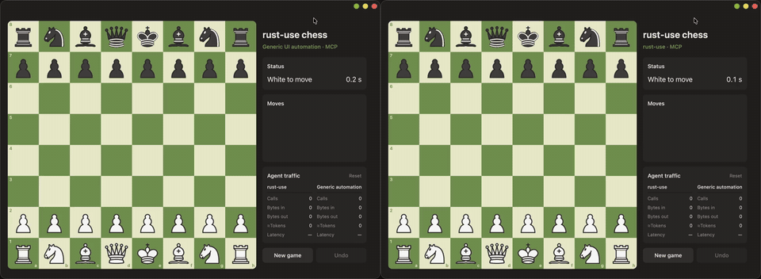

<p align="center">
  <picture>
    <source media="(prefers-color-scheme: dark)" srcset="https://shieldcn.dev/header/surface.svg?title=rust-use&amp;subtitle=A+library+of+behaviors+for+agents+to+build+and+drive+user+interfaces&amp;logo=https%3A%2F%2Fraw.githubusercontent.com%2Fbetter-vault%2Frust-use%2Fmain%2F.github%2Fassets%2Flogo-dark.png&amp;mode=dark&amp;align=center&amp;font=geist-mono&amp;border=false" />
    
  </picture>
</p>

<p align="center">
  <a href="https://crates.io/crates/rust-use"></a>
  <a href="https://docs.rs/rust-use"></a>
  <a href="https://github.com/better-vault/rust-use"></a>
</p>

<p align="center">
  Behaviors, not pixels · One snapshot, one action · Built for GPUI.<br />
  Agents drive your Rust UI in a few calls instead of dozens.
</p>

<p align="center">
  <a href="https://docs.rs/rust-use"><b>Documentation</b></a> ·
  <a href="#getting-started">Installation</a> ·
  <a href="#behaviors">Behaviors</a> ·
  <a href="#agents">Agents</a> ·
  <a href="#benchmark">Benchmark</a> ·
  <a href="#example-the-chess-demo">Chess demo</a>
</p>

---

**rust-use is a Rust library of UI behaviors that agents use to build and drive user
interfaces.** Selection, focus, toggles, lists, popups and drag-and-drop are written once as
behaviors. You compose them into components with a derive macro, and every component you mount is
something an agent can see and operate by name, with no screenshots, accessibility-tree crawling
or pixel clicks.

It is built for [GPUI](https://gpui.rs), the GPU-accelerated UI framework behind Zed, and the core
has no UI dependency at all.

<p align="center">
  
</p>

<p align="center">
  <sub>Claude Code plays the same game in the same app, started at the same moment. Left: generic UI
  automation over MCP. Right: rust-use over MCP. Real time, not sped up.
  <a href=".github/assets/race.mp4">Full-quality video</a> · <a href="#benchmark">numbers</a></sub>
</p>

> [!WARNING]
> **rust-use is in beta.** It is pre-1.0, and APIs, the compact format and the set of behaviors may
> change between minor releases (0.1 → 0.2) while the design settles. Pin a minor version, read the
> [changelog](CHANGELOG.md) before upgrading, and please
> [report what breaks](https://github.com/better-vault/rust-use/issues/new?template=bug_report.yml).

## Why rust-use

- 🎯 **Behaviors, not pixels.** An agent calls `board move e2e4`, not "find the square, click
  it, find the other square, click it".
- 🪶 **Token-lean by design.** The compact snapshot uses one line per component. After an action,
  the agent gets back only the lines that changed, not the whole screen again.
- ⚡ **In-process and native.** The bridge runs inside your app. Agents reach it over a local
  socket through the `rust-use` CLI, with no MCP server process in between. An MCP shim is there
  for clients that need it.
- 🛡️ **Every agent change is marked and can be vetoed.** Changes carry
  `ChangeSource::Agent` and pass through your `allow` hook first.
- 🧩 **One derive, zero boilerplate.** `#[derive(Primitive)]` plus `#[actions]` turns a plain
  struct and its methods into an agent-drivable component. The doc comments become what the
  agent reads.
- 📦 **One crate to add.** Run `cargo add rust-use` and import `rust_use::prelude::*`. Features
  stay additive and `unsafe` is forbidden.

## Getting started

Needs Rust 1.88+.

```sh
cargo add rust-use
```

With the GPUI adapter:

```sh
cargo add rust-use --features gpui
```

| Feature | Default | What it adds |
| --- | --- | --- |
| `macros` | ✓ | `#[derive(Primitive)]` and `#[actions]` |
| `agent` | ✓ | The agent bridge: `snapshot`, `diff`, `act`, `query`, `allow` |
| `gpui` | | The GPUI adapter |
| `ipc` | | A local socket server so the `rust-use` CLI can drive a running app |
| `mcp` | | The same three tools served over MCP |

## Usage

```rust
use rust_use::prelude::*;

/// A button that mutes audio.
#[derive(Primitive, Default)]
struct MuteButton {
    #[agent(value)]
    muted: bool,
}

#[actions]
impl MuteButton {
    /// Mute or unmute.
    fn toggle(&mut self) {
        self.muted = !self.muted;
    }
}

let ui = Ui::new();
ui.mount(MuteButton::default()).label("Mute");

let agent = ui.agent();
println!("{}", agent.snapshot());
// rev 2
// @1 mute-button "Mute" =false !toggle

agent.act("Mute toggle")?;
```

## Behaviors

Behaviors embed into a component with `#[behavior]`. Their state and actions merge into the
component's own.

- **Input**: `press`, `toggle`, `value`
- **Collections**: `selection`, `list` (searchable through `query`)
- **Focus and keys**: `roving_focus` (lists and 2-D grids), `typeahead`
- **Overlays**: `popup`
- **Pointer**: `drag_drop`

## Agents

An agent needs three tools, whichever way it connects:

| Tool | What it does |
| --- | --- |
| `snapshot` | Lists every component: ref, kind, label, value and the actions available right now |
| `act` | Runs one or more steps in order and returns only what changed |
| `query` | Pages through long option lists, such as a country picker |

It can connect three ways:

- **In process**: `ui.agent()`, for tests and for embedding a model in your app.
- **CLI over a local socket**: `rust-use snapshot`, `rust-use act "board move e2e4"`. Any coding
  agent that can run a shell command can use it, including Claude Code, Codex and Cursor.
- **MCP**: `rust-use mcp` serves the same tools to any MCP client.

## Benchmark

Claude Code (Sonnet 5.5) plays a complete chess game, the 33-ply
[Opera Game](https://en.wikipedia.org/wiki/Opera_Game), in the running GPUI chess demo. It plays the
same app, the same board and the same prompt through each interface. Every run below ended in
checkmate on the expected position. Values are medians of 3 runs.

| | Tool calls | Input tokens | Time | Cost |
| --- | ---: | ---: | ---: | ---: |
| Generic UI automation (MCP: UI tree + click) | 70 | 139,838 | 31 s | $0.161 |
| **rust-use** (MCP) | **3** | **19,179** | **8 s** | **$0.027** |
| **rust-use** (CLI over a local socket) | **3** | **24,147** | **8 s** | **$0.028** |

That is **23× fewer tool calls, 7.3× fewer input tokens, 3.9× faster and 6× cheaper** for the same
finished game. rust-use over MCP and rust-use over the CLI land in the same place, so the saving
comes from the interface, not the transport. The agent sees one line for the board, and every
`act` returns only what changed.

On the wire, with no model involved, replaying the game through generic automation moves **43×
more tokens** than rust-use with one `act` per move, and **208× more** than a single batched `act`.

Method, fairness notes and the commands to reproduce all of this are in
[`bench/README.md`](bench/README.md). The numbers are self-reported, from one machine.

## Example: the chess demo

A GPUI chess board that Claude Code plays move by move, in three ways: a generic MCP automation
server, the rust-use CLI, and rust-use over MCP. It is the benchmark above, and a working example
of every layer of the library.

```sh
git clone https://github.com/better-vault/rust-use.git
cd rust-use
cargo run -p chess-demo
```

## Contributing

Contributions are welcome. The crates live in [`crates/`](crates), the chess demo in
[`demos/chess`](demos/chess) and the benchmark in [`bench/`](bench).

```sh
cargo test --workspace --all-features                                  # every test
cargo clippy --workspace --all-targets --all-features -- -D warnings   # lint
cargo fmt --all                                                        # format
```

Read **[CONTRIBUTING.md](CONTRIBUTING.md)** before opening a pull request, and please follow the
**[Code of Conduct](CODE_OF_CONDUCT.md)**.

## Community

- **[Report a bug](https://github.com/better-vault/rust-use/issues/new?template=bug_report.yml)** or
  **[request a behavior](https://github.com/better-vault/rust-use/issues/new?template=feature_request.yml)**
- **[Ask a question](https://github.com/better-vault/rust-use/discussions)** in Discussions
- Star the repo if rust-use is useful to you. Stars are how other people find it.
- **[Sponsor the project](https://github.com/sponsors/Khalidabdi1)** to keep it moving

## Contributors

Thank you to everyone who has shipped something here. If you would like to join them,
**[CONTRIBUTING.md](CONTRIBUTING.md)** is the place to start.

<p align="center">
  <a href="https://github.com/Khalidabdi1" title="@Khalidabdi1"></a>
</p>

## License

[MIT](LICENSE) © Khalid Abdi
